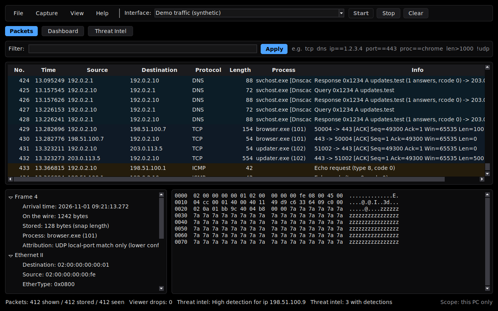
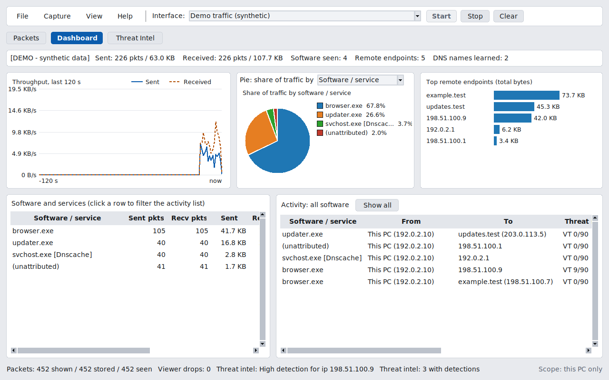
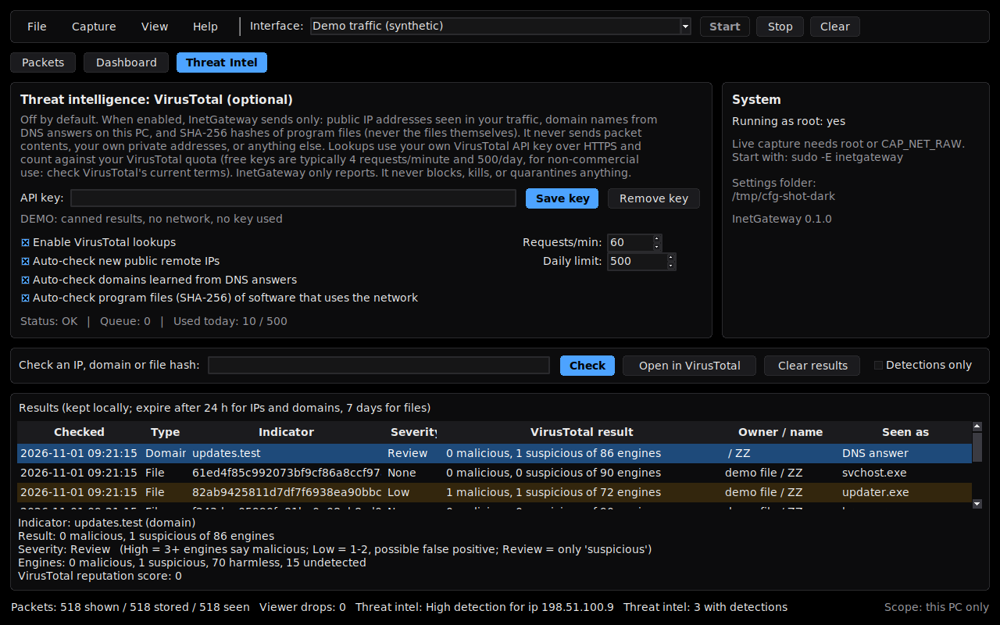

# InetGateway

A small, Wireshark-style traffic viewer for **Windows 10/11 and Linux**, with a per-application **dashboard**. One Python file, standard library only, rounded light and true-black dark themes.
**Offline by default**: the only network activity it can ever start is the optional VirusTotal lookups you switch on yourself.

> **Status: beta (0.x).** The decoders, dashboard, Linux capture and VirusTotal logic are tested (see [Verification](#verification)). The Windows capture paths (raw socket, Npcap) and the real VirusTotal calls have **not** yet been run on real Windows hardware / against the live service by the author. Screenshots show clearly labelled demo data.

## What it does

- **Packets tab**: live capture, decoded layers, hex view, display filters, save/open `.pcap`, CSV export. Decodes Ethernet/VLAN, IPv4, IPv6, ARP, TCP, UDP, ICMP/ICMPv6, IGMP and DNS/mDNS.
- **Dashboard tab**: which software or service used the network, what it sent and received, to and from which address (with DNS names learned from DNS answers), when, a throughput graph, pie chart and top-remote bar chart.
- **Threat Intel tab**: optional, off-by-default [VirusTotal](docs/THREAT_INTEL.md) checks of remote IPs, domains and program hashes with your own API key; results appear next to the software involved. It only reports: it never blocks, kills or quarantines anything.
- Process attribution from the OS connection tables (Windows) or `/proc` (Linux), with Windows service names and systemd unit names.

## Install

Download from the **[Releases](../../releases)** page (check `SHA256SUMS.txt`).

| System | File | How |
|---|---|---|
| **Windows 10/11 (64-bit)** | `InetGateway-<version>-windows-x64.exe` | Run it. SmartScreen warns because it is **not code-signed** (More info > Run anyway). For live capture: right-click > *Run as administrator*. Optional: install [Npcap](https://npcap.com/) for IPv6/ARP/loopback (read its licence; it is not bundled). |
| **Debian / Ubuntu** | `inetgateway_<version>-1_all.deb` | `sudo apt install ./inetgateway_<version>-1_all.deb`, then `sudo -E inetgateway` for live capture. Depends on `python3 (>= 3.9)` and `python3-tk`. |
| **Anything with Python 3.9+ and tkinter** | this repository | `python3 inetgateway.py` (add `--demo` to try it with synthetic traffic) |

Live capture needs administrator (Windows) or root / `CAP_NET_RAW` (Linux). Details and alternatives: [Troubleshooting](docs/TROUBLESHOOTING.md).

## What it can and cannot see

"Every packet on the network" is impossible for any program on a normal PC, including Wireshark.

- It sees **this computer's** traffic (plus broadcast/multicast). Other devices' traffic on a switch or router needs a mirror port or router-side capture.
- **Encrypted** traffic (HTTPS, QUIC) is shown as headers and sizes only; nothing is decrypted. By default only the first 128 bytes per packet are stored.
- Windows raw-socket mode: IPv4 only, no loopback. Npcap (Windows) and Linux capture add Ethernet frames, IPv6, ARP and loopback.
- Heavy traffic can overrun the viewer or the OS buffers; drops are counted in the status bar (viewer-side only).
- "Sent/Received" are packet directions at this PC, **not** HTTP requests/responses. Blank Process means unknown, never a guess.

Full explanation: [docs/NETWORK_MONITORING.md](docs/NETWORK_MONITORING.md).

## Privacy in one paragraph

Packets stay in memory unless you save them. With lookups off (default) no network connection is started: no telemetry, no update checks, no accounts. If you enable VirusTotal lookups, only public IPs, public domain names and file SHA-256 hashes are sent, with your key, over HTTPS to `www.virustotal.com`; never file contents or paths, packet data, or private addresses. Everything stored and sent: [docs/PRIVACY.md](docs/PRIVACY.md).

## Documentation

[User guide](docs/USER_GUIDE.md) · [Network monitoring and limits](docs/NETWORK_MONITORING.md) · [Threat intelligence](docs/THREAT_INTEL.md) · [Privacy](docs/PRIVACY.md) · [Troubleshooting](docs/TROUBLESHOOTING.md) · [Architecture](docs/ARCHITECTURE.md) · [Development](docs/DEVELOPMENT.md) · [Releasing](docs/RELEASING.md) · [Security policy](SECURITY.md) · [Changelog](CHANGELOG.md)

## Verification

What was actually run (Linux, Python 3.12, virtual display, root for capture): **107 automated tests, 106 run and passed, 1 skipped** (no IPv6 loopback on the test machine). They cover decoders (including ~20,000 fuzzed packets without a crash), filters, bounded storage and queues, pcap/CSV, settings corruption, process attribution, the dashboard statistics, the VirusTotal engine (fake responders only; a guard fails the test if the real network function is called), the GUI in demo mode, and **real loopback captures on Linux with exact packet and byte counts and attribution to the test's own process**.

**Not verified yet:** capture on real Windows hardware (raw socket, Npcap), Windows process/service attribution against real tables, DPAPI key encryption, real requests to VirusTotal (the endpoints and fields follow its v3 API as checked from public documentation), the packaged `.exe` (built and smoke-tested only by the release workflow), Linux capture on a physical desktop session (tested in a headless container), and Python versions other than 3.12 until CI has run them.

## Licence

GPL-3.0-or-later (see [LICENSE](LICENSE)); third-party notices in [THIRD_PARTY_LICENSES.md](THIRD_PARTY_LICENSES.md). Binaries are built from the tagged source in this repository. VirusTotal and Npcap are separate third-party products with their own terms.
