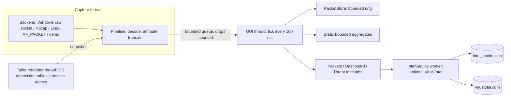

# Architecture

One Python file (`inetgateway.py`, standard library only, GUI with Tk). It is organised in layers inside the file; tests import it directly.

## Layers

| Layer | What it does |
|---|---|
| Decoders (`decode`, `_ipv4`, `_ipv6`, `_l4`, `_dns`, ...) | Pure functions over bytes. Never raise on hostile input (fuzz-tested). Strings are sanitised (`safe_text`). |
| Filters (`compile_filter`) | Small term language compiled to predicates. |
| Storage (`PacketStore`, config, pcap, CSV) | Bounded ring buffer; atomic file writes (temp file + `os.replace`); CSV formula-injection escaping. |
| Attribution (`Attributor`, `ProcessNames`) | Maps a packet to a process via a snapshot of the OS connection tables. Unknown stays blank. |
| Backends | `RawSocketBackend`, `NpcapBackend` (ctypes to `wpcap.dll`), `LinuxPacketBackend`, `DemoBackend`; all with `open()`, `run(feed, stop)`, `close()`. |
| `Stats` | Cumulative per-software, per-flow, per-protocol and per-second counters, with hard size caps. |
| Intel (`IntelService`, `IntelCache`, `KeyStore`, `VTClient` helpers) | Optional lookups: bounded priority queue, rate limit, daily cap, cache, no redirects. |
| GUI (`App`, `DashboardView`, `ThreatIntelView`, `Card`, `RButton`, `TabView`) | Tk/ttk with custom rounded widgets drawn on canvases. |

## Threads

1. **GUI thread** (Tk main loop): all widgets, `PacketStore`, `Stats`. Drains up to 300 packets per 100 ms tick, so it never blocks on capture.
2. **Capture thread**: reads from the backend, decodes, looks up the process, and enqueues. The queue is bounded (20,000); overflow is dropped and counted.
3. **Table refresher** (once per second; service names every 10 s): replaces the connection-table snapshot atomically.
4. **Intel worker** (only while lookups are enabled): the only thread that can use the network.

## Data flow for a packet

backend bytes → `Pipeline.feed` (decode, `Attributor.lookup`, truncate to the snap length) → queue → GUI tick → `PacketStore` + `Stats` (+ packet list row if it matches the filter) → Dashboard refresh once per second while that tab is visible.

## Boundaries and limits

- No database; JSON/pcap/CSV only; settings in the user's config directory.
- Nothing runs elevated unless you start it elevated: there is no service, no IPC and no installer component.
- Every queue, table and cache has a hard cap (packets 50,000 by default, display rows 10,000, apps 500, flows 5,000, series 600 s, intel cache 5,000, pending lookups 200).
